# Fabric Hospitality Analytics & AI Demo – Kyanos Hotels & Resorts

End-to-end **Microsoft Fabric** demo for **hotel groups**. It shows how a group that runs an on-premises PMS on SQL Server, with a nightly batch into a data warehouse, can move to:
- one copy of its data in OneLake;
- **near real-time** Power BI;
- **AI demand forecasting**;
- **natural-language Q&A** in Greek or English.

The whole demo deploys into an empty workspace with **one command** (about 20 minutes).

The story follows **Kyanos Hotels & Resorts**, a *fictional* Greek hotel group:
- 24 hotels: 20 seasonal resorts on Crete, Rhodes, Kos, Corfu, the Cyclades, Halkidiki, the Peloponnese, Zakynthos and Attica, plus city hotels in Athens, Heraklion and Thessaloniki;
- its PMS, Salesforce CRM, SAP costs and airline seat-capacity data;
- every guest, booking and number is synthetic.

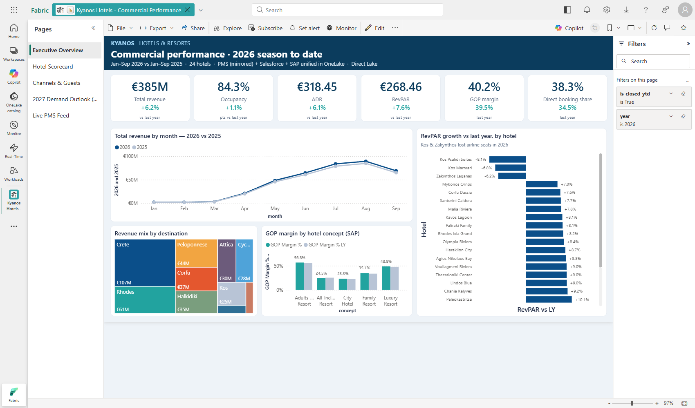

---

## What the demo shows

| Act | Fabric capability | What the audience sees |
|---|---|---|
| 1 | **Mirroring** from a SQL PMS | Reservations saved in the PMS appear in Power BI in **~13 seconds**, with no ETL and no overnight batch. |
| 2 | **OneLake + shortcut + notebooks** | PMS, Salesforce, SAP and airline data unified in one schema-enabled lakehouse. The PMS arrives through a **zero-copy shortcut**. |
| 3 | **Direct Lake semantic model** | One governed model: 11 tables, 15 relationships, **53 DAX measures** (Occupancy, ADR, RevPAR, GOP, pace, forecast), and RLS per hotel and region. |
| 4 | **Power BI report + Copilot** | 5 pages. Kos and Zakynthos underperform because airlines cut seats; Kos Marmari has an air-conditioning complaint cluster; the direct-booking strategy is working. |
| 5 | **Data Science + MLflow** | Summer 2027 occupancy forecast from booking pace and published airline seat capacity. It beats "same as last year" (MAE 3.3 vs 4.1 points). |
| 6 | **Fabric data agent** | Questions in **Greek or English**, answered from the same measures as the report. |
| 7 | **Fabric IQ ontology** | Hotels, airports, VIP guests, upcoming stays, open cases and tour operators as a navigable business graph. |

A presenter talk track is in [docs/DEMO_SCRIPT.md](docs/DEMO_SCRIPT.md). Full solution documentation (49 pages: architecture, relationship diagram, DAX catalog, queries, build log) is in [docs/Kyanos_Fabric_Solution_Documentation.pdf](docs/Kyanos_Fabric_Solution_Documentation.pdf).

## Walkthrough

### Act 1 · From night batch to near real time

`KyanosPMS` is a **Fabric SQL database** standing in for an on-premises Protel / SQL Server PMS. Every table is replicated to OneLake as Delta automatically. Its replication monitor shows all four PMS tables running:

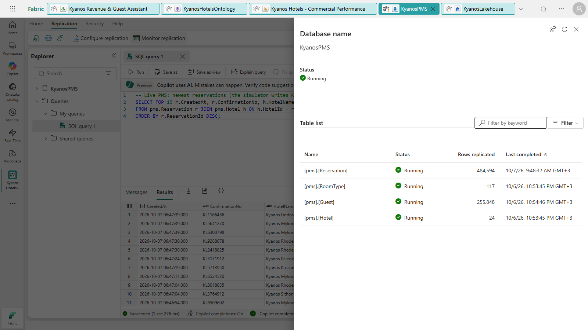

The local simulator writes new bookings into the PMS every few seconds (`KL…` confirmation numbers):

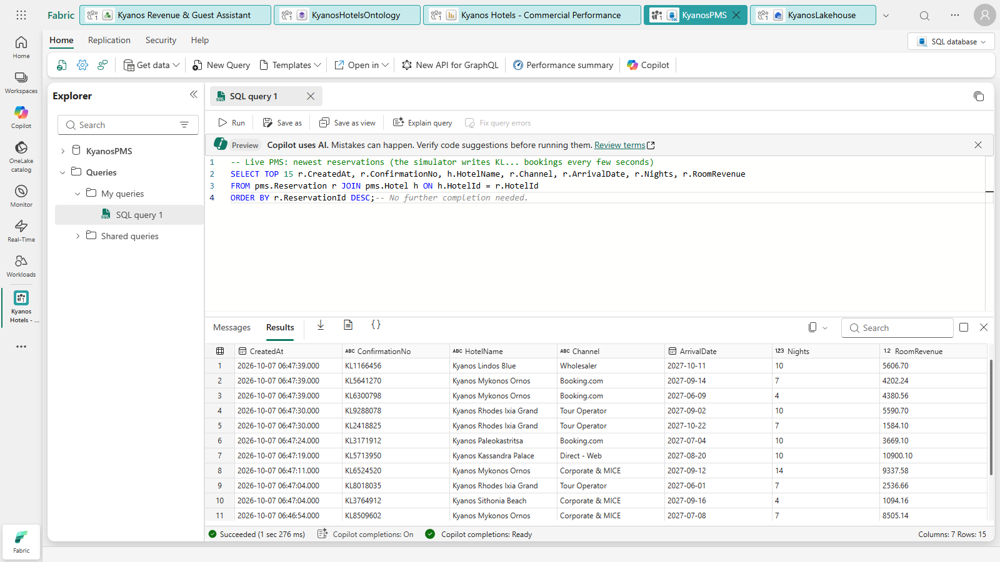

About 13 seconds later they are in Power BI. The **Live PMS Feed** page reads the mirrored table through Direct Lake, so no refresh is needed:

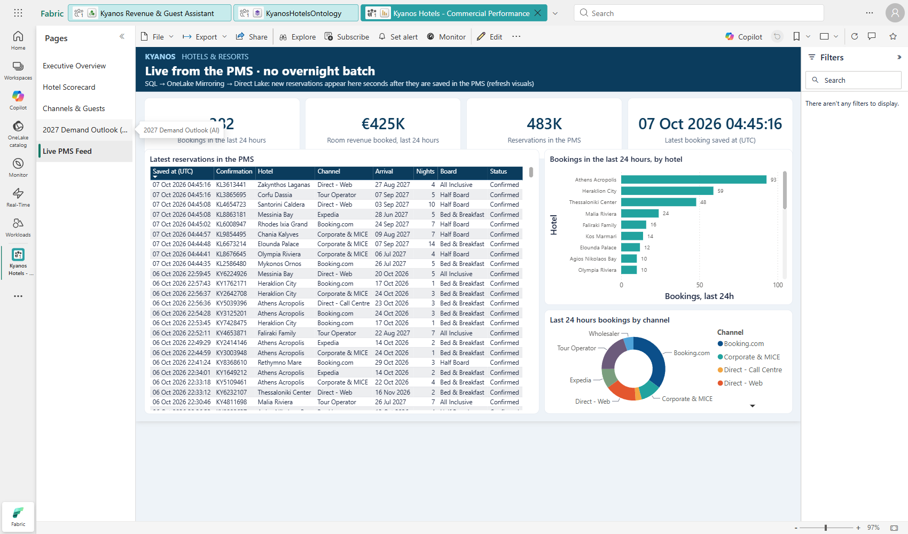

> For an on-premises SQL Server 2016–2022, use the **Mirrored database** item through the on-premises data gateway. It relies on CDC and needs a primary key on every table. See [Important considerations](#important-considerations).

### Act 2 · One lake, many sources

`KyanosLakehouse` is schema-enabled:

| Schema | Content |
|---|---|
| `pms` | One **schema-level OneLake shortcut** to the mirrored PMS tables (zero copy) |
| `crm` | Salesforce: Privilege Club members and cases |
| `erp` | SAP monthly hotel costs |
| `ext` | Airline seat capacity |
| `gold` | The star schema |

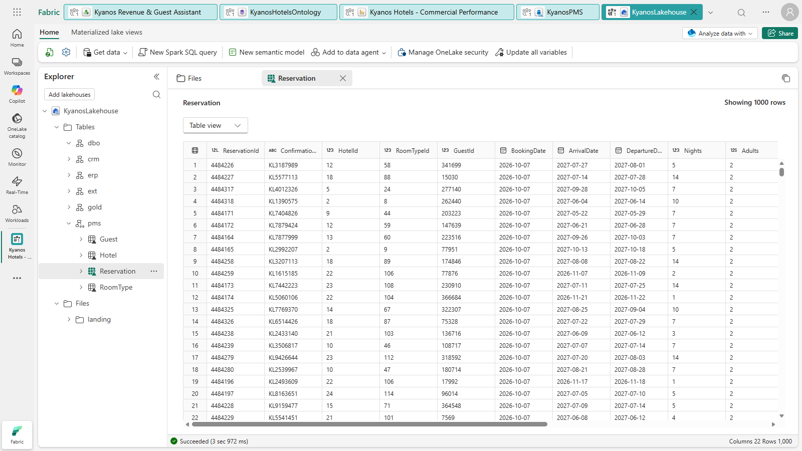

Notebooks build the gold layer. They handle data quality on the way: de-duplicating Privilege Club IDs, exploding stays into hotel-nights, and applying a hotel open/closed calendar.

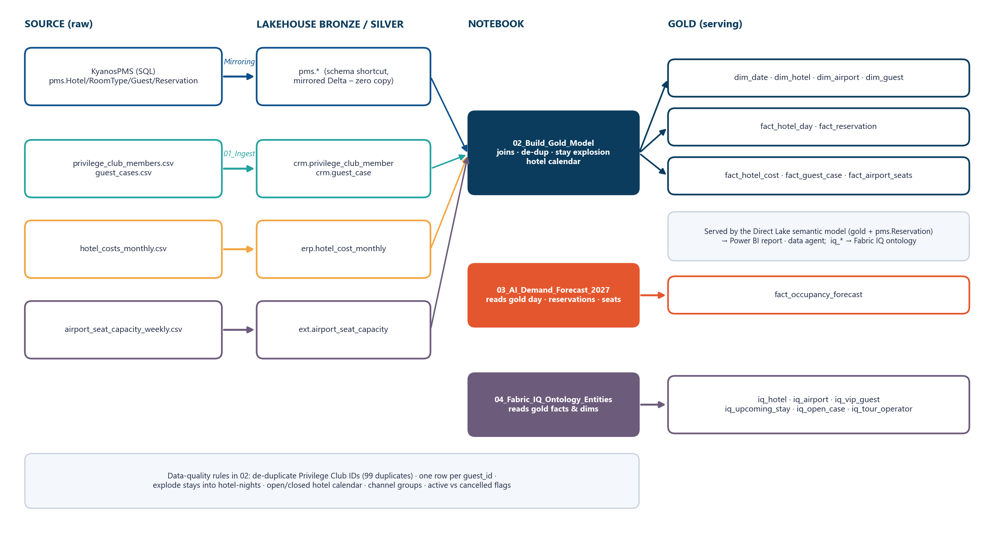

### Act 3 · One governed semantic model

`Kyanos Hotels Model` is **Direct Lake on OneLake**. It has conformed `dim_date` and `dim_hotel` dimensions, a date-table-driven last-year comparison on every fact, and a virtual relationship (`TREATAS`) from hotels to airline seats. It also includes the live `pms.Reservation` table.

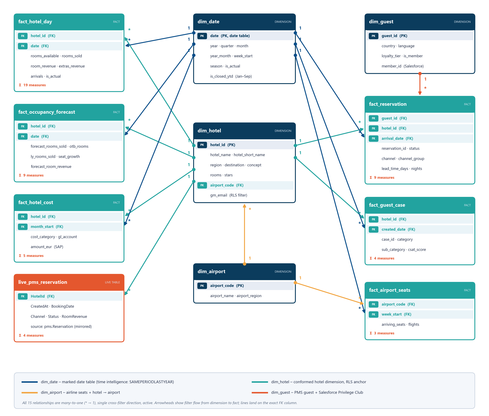

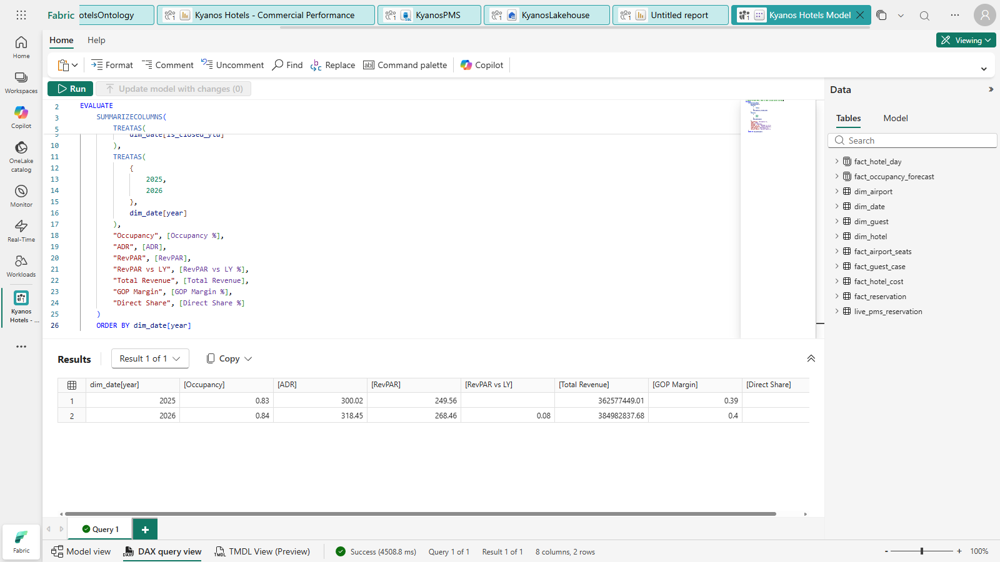

### Act 4 · Power BI report (and Copilot)

The **Hotel Scorecard** puts PMS revenue, SAP costs (GOP) and Salesforce cases side by side. Click *Kos Marmari* to see its air-conditioning complaint cluster.

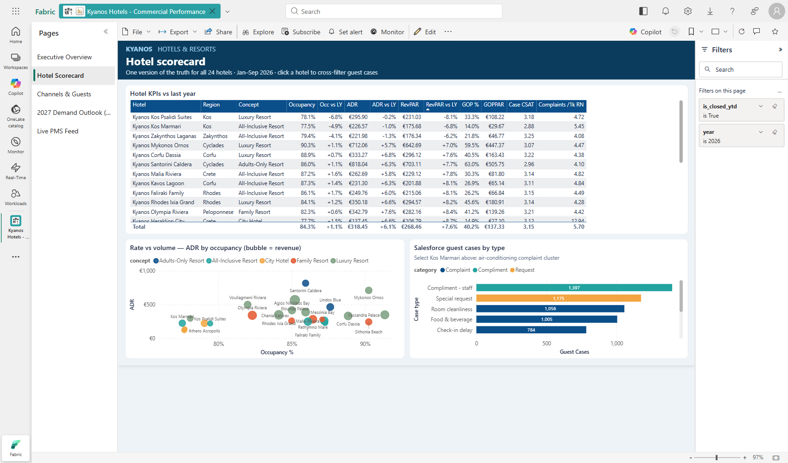

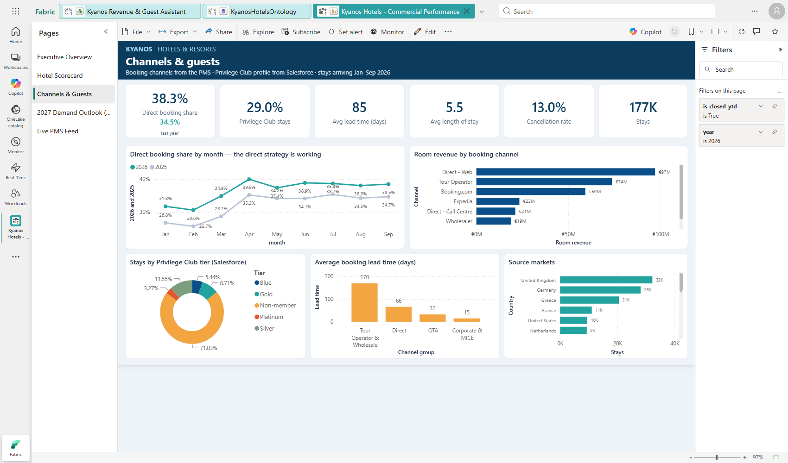

### Act 5 · AI demand forecast for Summer 2027

Notebook `03_AI_Demand_Forecast_2027` trains a gradient-boosting model that predicts the **change in occupancy versus last year** for every hotel-night. It uses:
- **booking pace** versus the same point last year;
- **published airline seat capacity** at the hotel's airport;
- monotonic constraints, so more seats or a stronger pace can only push the forecast up.

The run is tracked and registered with MLflow.

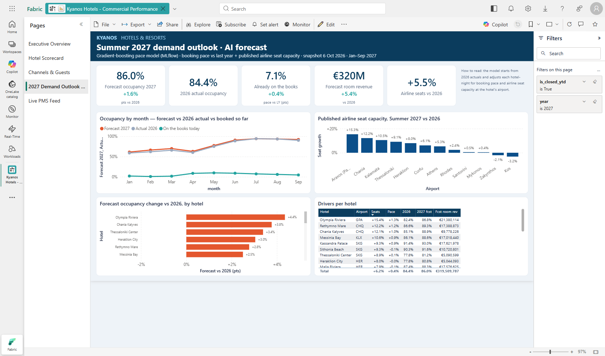

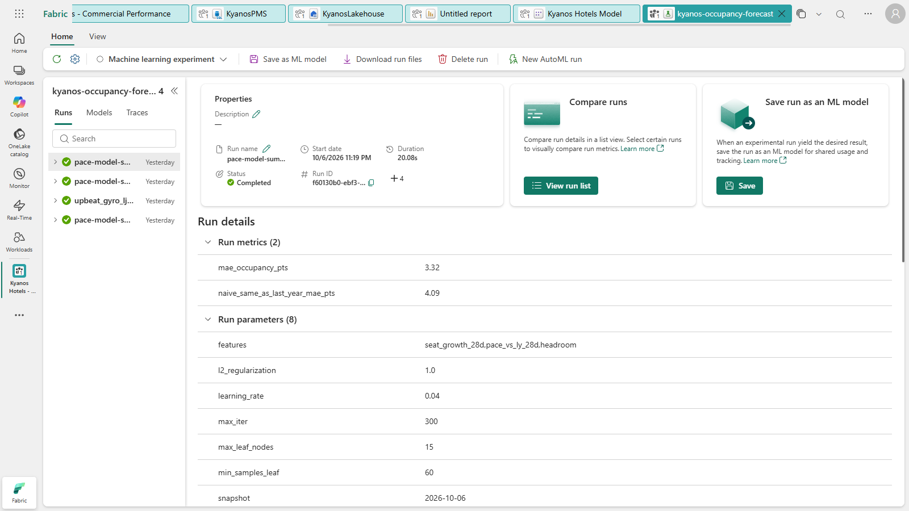

### Act 6 · Ask the data – in Greek or English

**Kyanos Revenue & Guest Assistant** is a Fabric data agent over the semantic model. Its numbers therefore always match the report.

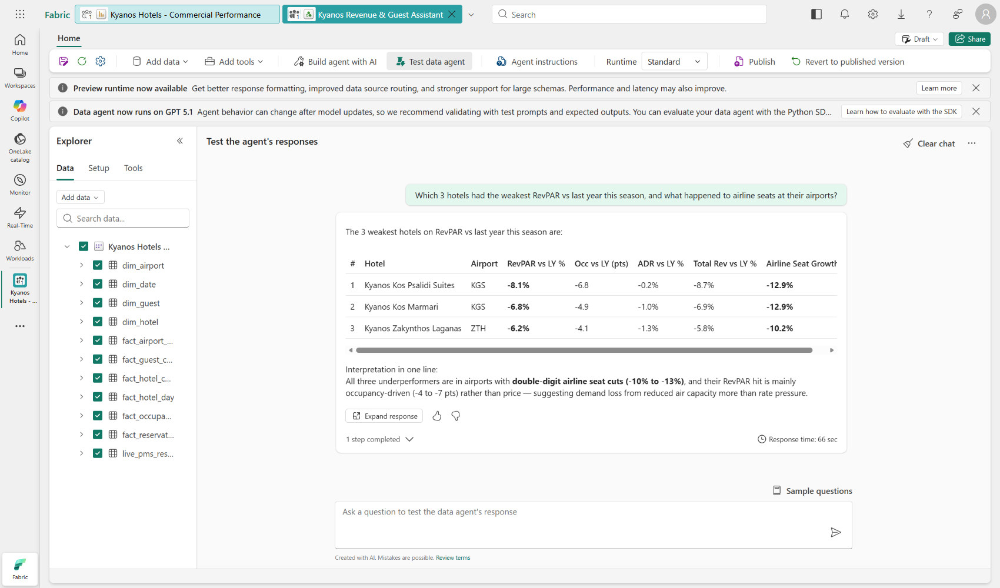

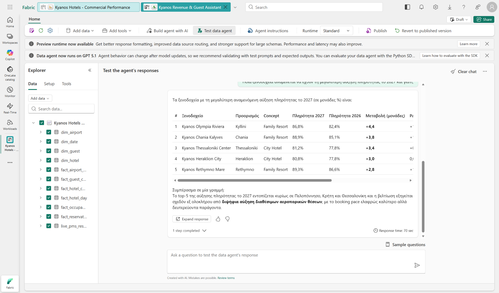

### Act 7 · Fabric IQ ontology

`KyanosHotelsOntology` has 6 entity types and 5 relationships:

| Relationship | From | To |
|---|---|---|
| `served_by` | Hotel | Airport |
| `stays_at` | UpcomingStay | Hotel |
| `booked_by` | UpcomingStay | VipGuest |
| `sold_by` | UpcomingStay | TourOperator |
| `case_at` | OpenCase | Hotel |

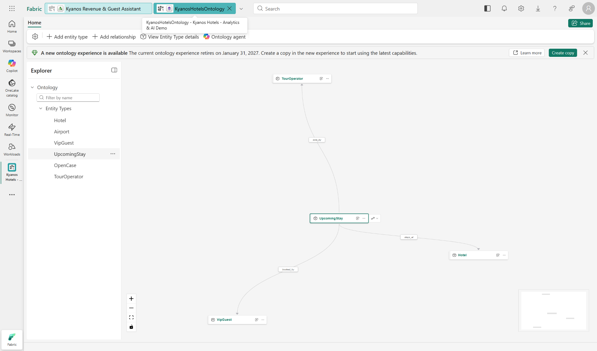

## Architecture

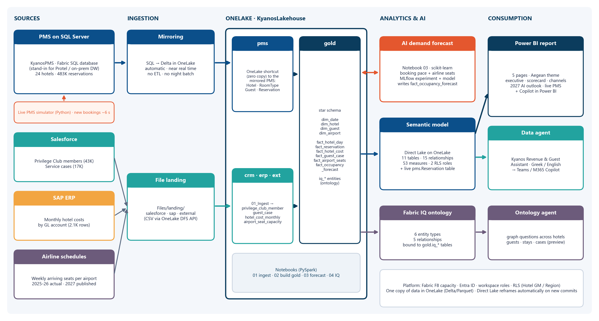

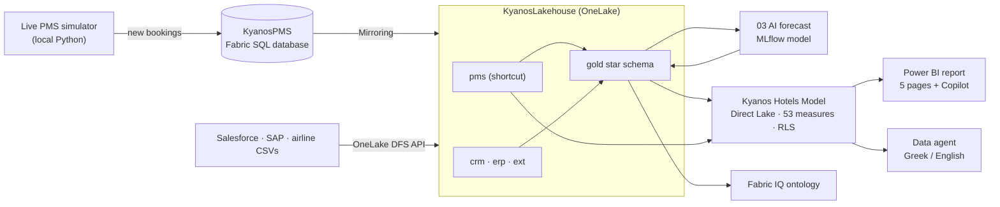

### Fabric items created

The workspace is organised in folders that follow the architecture:

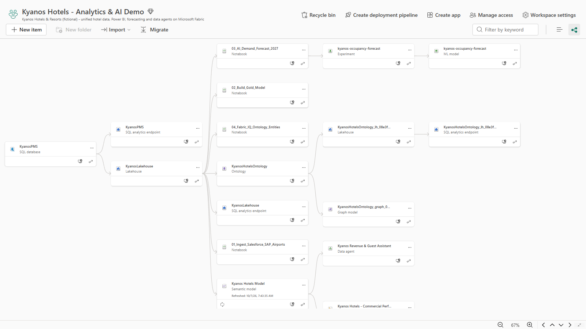

| Folder | Item | Type | Purpose |
|---|---|---|---|
| 1 Sources PMS on SQL | `KyanosPMS` | SQL database | The "PMS": 24 hotels, 117 room types, 255,848 guests, 482,961 reservations. Replicated to OneLake automatically. |
| 2 OneLake unified data | `KyanosLakehouse` | Lakehouse (schemas) | `pms` shortcut, `crm`, `erp`, `ext`, `gold` (10 model tables + 6 ontology entity tables) |
| 2 OneLake unified data | `01_Ingest_Salesforce_SAP_Airports`, `02_Build_Gold_Model` | Notebooks | Typed landing; star schema with data-quality rules |
| 3 AI forecasting | `03_AI_Demand_Forecast_2027`, `kyanos-occupancy-forecast` | Notebook, ML experiment, ML model | Booking-pace + airline-seat forecast for Jan–Sep 2027 |
| 4 Power BI | `Kyanos Hotels Model` | Semantic model (Direct Lake) | 11 tables, 15 relationships, 53 measures, 2 RLS roles |
| 4 Power BI | `Kyanos Hotels - Commercial Performance` | Report (PBIR) | Executive Overview, Hotel Scorecard, Channels & Guests, 2027 Demand Outlook (AI), Live PMS Feed |
| 5 Agents and Fabric IQ | `Kyanos Revenue & Guest Assistant` | Data agent | Instructions + semantic-model source, published |
| 5 Agents and Fabric IQ | `KyanosHotelsOntology`, `04_Fabric_IQ_Ontology_Entities` | Ontology (+ graph), notebook | Business entities over `gold.iq_*` |

## Quick start

> Coding agents: follow [AGENTS.md](AGENTS.md). It covers the same steps with expected outputs, verification checks and fixes.

### Prerequisites

- A **Fabric capacity**, F2 or larger (tested on F4 and F8), and permission to create a workspace on it.
- Tenant settings enabled for:
  - Fabric items and **SQL database**;
  - **Copilot / Azure OpenAI**;
  - the **data agent**;
  - **Ontology (Fabric IQ)**.
- **Azure CLI**, signed in to the tenant (`az login`). All calls use `az account get-access-token`.
- **Python 3.10+**, then `pip install -r requirements.txt`. The `mssql-python` package bundles its own SQL driver, so no ODBC install is needed.
- PowerShell for `demo-control.ps1`.

### Deploy

```powershell
Copy-Item config.example.json config.json   # set capacityId (and subscription or tenantId if you have several)
python src/gen_data.py                      # synthetic data into data/ (~40 s, deterministic)
python src/deploy.py all                    # everything, in order (~20 min) - resumable
```

`deploy.py all` runs these steps. Each step is idempotent and can also be run on its own, e.g. `python src/deploy.py model report`.

| Step | What it does |
|---|---|
| `infra` | Workspace, schema-enabled lakehouse, Fabric SQL database |
| `pms` | Creates the `pms` tables and loads ~740K rows over TDS with an Entra token (~6 min) |
| `wait-mirror` | Waits until the four PMS tables are Delta in OneLake |
| `landing` | Uploads the Salesforce, SAP and airline CSVs to `Files/landing` |
| `shortcut` | `Tables/pms` schema shortcut to the mirrored tables |
| `notebooks` · `run` | Creates notebooks 01–04 and runs 01 → 02 → 03 (→ 04) |
| `model` | Direct Lake semantic model (TMDL) and reframe |
| `report` | Power BI report (PBIR) with the custom theme |
| `agent` | Data agent with its semantic-model source, published |
| `ontology` | Fabric IQ ontology |
| `folders` | Organises the workspace into folders |
| `status` | Lists items, runs a DAX check and prints the links |

No portal steps are required. A successful run ends with `status` printing a DAX check like this:

```
model check: [{'[reservations]': 482961, '[revenue_2026]': 418613919.27, '[forecast_occ_2027]': 0.8598}]
```

## Running the demo

```powershell
./demo-control.ps1 warmup              # reframe the model, sync the SQL endpoint, warm the cache
./demo-control.ps1 start               # live PMS bookings every ~6 s (log: sim.log)
./demo-control.ps1 burst 25 KYN-OLY    # a 25-room tour-operator group block at Olympia Riviera
./demo-control.ps1 status
./demo-control.ps1 stop                # or: reset  (also deletes all simulator bookings)
```

New PMS bookings appear on the **Live PMS Feed** page after about 13 seconds; refresh the visuals to see them. The data snapshot date is **6 October 2026**: everything before it is realised, everything after it is on-the-books business or forecast.

## Repository layout

```
├── AGENTS.md                  # step-by-step runbook for coding agents
├── config.example.json        # capacityId, workspaceName, optional subscription / tenantId / stateFile
├── demo-control.ps1           # warmup | start | burst | status | stop | reset
├── requirements.txt
├── data/                      # generated by src/gen_data.py (git-ignored)
├── docs/
│   ├── DEMO_SCRIPT.md         # presenter talk track (customer-agnostic)
│   ├── Kyanos_Fabric_Solution_Documentation.pdf / .docx
│   ├── images/                # README screenshots and diagrams
│   └── build/                 # scripts that regenerate the documentation and diagrams
└── src/
    ├── fab.py                 # Fabric REST helper: Azure CLI tokens, LRO polling, definitions
    ├── deploy.py              # step-based, idempotent deployer (python src/deploy.py all)
    ├── gen_data.py            # synthetic hotels, reservations, guests, CRM, ERP, airline seats
    ├── load_pms.py            # PMS DDL + loader;  sqlconn.py: Entra-token SQL connection
    ├── notebooks.py           # notebook sources 01-04 (Fabric git format)
    ├── model.py               # semantic model: tables, 53 measures, relationships, RLS -> TMDL
    ├── report.py              # Power BI report pages, visuals and theme -> PBIR
    ├── agent.py               # data agent instructions + semantic-model data source
    ├── ontology.py            # Fabric IQ entity types, bindings and relationships
    ├── pms_live_sim.py        # live PMS simulator (run / burst / status / reset)
    └── warmup.py              # pre-demo warm-up
```

## Customising

| To change | Where |
|---|---|
| Hotels, room types, seasons, prices | `src/gen_data.py` (hotel list `H`, curves `OCC_*`, `ADR_*`, channel mix `MIX`) |
| Business stories | `G26`/`G27` airline seat growth, hotel `perf` factors, case mix in `src/gen_data.py` |
| Snapshot date | `AS_OF` in `src/gen_data.py` and `src/notebooks.py` |
| Measures, relationships, RLS | `src/model.py`, then `python src/deploy.py model` |
| Report pages and visuals | `src/report.py`, then `python src/deploy.py report` |
| Agent instructions | `src/agent.py`, then `python src/deploy.py agent` |

## Important considerations

- **SQL Server mirroring (2016–2022):**
  - Uses CDC; every mirrored table needs a primary key.
  - Runs from the primary replica of an availability group only.
  - DDL changes stop mirroring until CDC is re-enabled for the table.
  - Source RLS, object-level permissions and dynamic data masking are not carried over to OneLake.
- **Lakehouse SQL endpoint:** for shortcut tables its metadata sync is lazy. Direct Lake picks up new rows in seconds, but the SQL endpoint may need `refreshMetadata`; `warmup` does this.
- **Time zone:** `NOW()` and `TODAY()` run in UTC in the service. The simulator writes UTC timestamps.
- **Personal data:** `dim_guest` holds names and emails. In real deployments, hide or secure PII with object-level security, sensitivity labels and masking.
- **Licensing:** Copilot and data agents work from F2. Report viewers need Power BI Pro below F64.

## Troubleshooting

| Symptom | Fix |
|---|---|
| `config.json not found` | `Copy-Item config.example.json config.json` and set `capacityId`. |
| `az` token error / wrong tenant | `az login --tenant <tenantId>`; set `tenantId` or `subscription` in `config.json`. |
| `data/ is empty` | `python src/gen_data.py` |
| `wait-mirror` waits for a long time | The SQL database may still be provisioning; re-run `python src/deploy.py wait-mirror`. |
| A notebook run fails | Open **Monitor** in Fabric for the cell error, fix `src/notebooks.py`, then `python src/deploy.py notebooks run-nb2` (or the failing one). |
| Visuals show *(Blank)* on the Live PMS page | Nothing was booked in the last 24 hours: `./demo-control.ps1 start` or `burst`. |
| A report shows an old version after redeploy | Hard-reload the browser (the service caches report definitions). |
| Data agent or ontology creation fails | Enable the data agent and Ontology tenant settings, then re-run `python src/deploy.py agent ontology`. |

## Disclaimer

This is a community demo, not an official Microsoft product or reference architecture. Kyanos Hotels & Resorts, its hotels, guests, partners and all data are fictional. Data agent and Ontology (Fabric IQ) are preview capabilities; their definitions may change.
